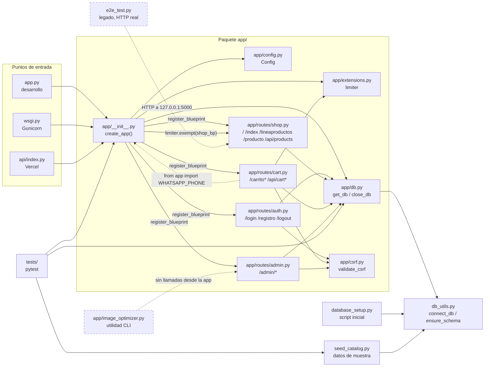
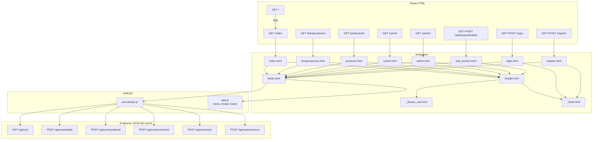

# 13 · Grafo del proyecto

Mapa de dependencias entre archivos, rutas, plantillas y scripts. Está pensado para que un modelo o un desarrollador sepa en segundos **qué archivo tocar** y **qué se rompe** si lo cambia.

> **Base:** commit `b77f5c5` (rama `main`), árbol limpio, revisado el **23 de noviembre de 2026**. Se verificó contra el código fuente. Los documentos 10 y 12 están desactualizados (ver [14 · Estado y pendientes §4](14-estado-draft-y-pendientes.md#4-documentación-desactualizada)).

---

## 1. Qué es el proyecto en una línea

Tienda Flask para joyería textil y marroquinería. El carrito vive en sesión, el precio se recalcula contra la base de datos y el pedido se cierra por WhatsApp. Base de datos SQLite en local y PostgreSQL en producción. Desplegable en Docker, Render o Vercel.

---

## 2. Grafo de dependencias de código (Python)

Flechas = "importa / usa". Los nodos con borde punteado son utilidades que no están conectadas a la aplicación.



### Lectura rápida del grafo

- **Todo pasa por `create_app()`.** Es el único sitio donde se registran blueprints, extensiones, filtros Jinja y el contexto global.
- **`app/db.py` es la puerta a la base de datos.** Todas las rutas llaman `get_db()`. Las rutas nunca importan `db_utils` directamente.
- **`db_utils.py` vive en la raíz, no dentro de `app/`.** Por eso `app/db.py` lo importa como módulo de nivel superior. Funciona porque la raíz del proyecto está en `sys.path`.
- **Dependencia circular controlada:** `cart.py` importa `WHATSAPP_PHONE` desde `app/__init__.py`. Funciona porque la constante se define antes de que se importen los blueprints dentro de `create_app()`. Si mueves esa constante o cambias el orden de importación, el arranque falla.
- **`image_optimizer.py` no tiene llamadas desde la aplicación.** Se usa a mano o desde la terminal. No aparece en ninguna ruta.

---

## 3. Grafo de rutas → plantillas → scripts → endpoints



### Puntos a recordar

- `login.html` y `registro.html` **no** incluyen `header.html`. Solo incluyen `_flash.html` y `footer.html`. Por eso no tienen menú.
- `footer.html` carga `cart-drawer.js` y `app.js` en **todas** las páginas que lo incluyen. Un error en cualquiera de los dos afecta a todo el sitio.
- Las plantillas de la carpeta `templates/` no tienen herencia (`base.html` no existe). Cualquier cambio de layout general se hace en `header.html` y `footer.html`.
- El carrito tiene **dos implementaciones paralelas**: rutas HTML (`/carrito/*`) que devuelven redirecciones, y rutas JSON (`/api/cart/*`) que usa el drawer. Un cambio en la lógica de precios debe hacerse en `get_cart_payload()`, que ambas usan.

---

## 4. Tabla de archivos

| Archivo | Responsabilidad | Lo usa | Riesgo al cambiarlo |
|---|---|---|---|
| `app/__init__.py` | Fábrica, blueprints, filtros, contexto global, `WHATSAPP_PHONE` | `app.py`, `wsgi.py`, `api/index.py`, `cart.py`, tests | **Alto**: rompe todo el arranque |
| `app/config.py` | Claves, cookies, límite de subida, validación | `create_app()` | **Alto**: seguridad de sesión |
| `app/extensions.py` | Límites de peticiones (Flask-Limiter) | `__init__.py`, `cart.py` | Medio |
| `app/db.py` | Conexión por petición | Todas las rutas | **Alto** |
| `app/csrf.py` | Validación del token en POST | `auth`, `cart`, `admin` | **Alto**: seguridad |
| `app/routes/auth.py` | Login, registro, logout | Blueprint `auth` | Medio |
| `app/routes/shop.py` | Catálogo público y API de productos | Blueprint `shop` | Medio (SEO y ventas) |
| `app/routes/cart.py` | Carrito, checkout y WhatsApp | Blueprint `cart`, drawer | **Alto**: precios y pedidos |
| `app/routes/admin.py` | Panel y CRUD | Blueprint `admin` | Alto: escritura en BD y disco |
| `app/image_optimizer.py` | Convierte fotos a WebP | Nadie (manual) | Bajo |
| `db_utils.py` | Conexión SQLite/PostgreSQL, esquema y migraciones | `app/db.py`, scripts | **Alto** |
| `database_setup.py` | Crea esquema y admin inicial | Manual | Medio |
| `seed_catalog.py` | Inserta productos de muestra | Manual, `tests/conftest.py` | Medio: escribe en la BD |
| `tests/` | Pruebas con pytest y base temporal (`tests/conftest.py`) | Manual | Bajo: nunca toca `database.db` |
| `e2e_test.py` | Prueba HTTP legado | Manual | Bajo; probablemente falla |
| `api/index.py` | Entrada para Vercel | `vercel.json` | Medio |
| `vercel.json` | Reescrituras a `/api/index` | Vercel | Medio |
| `templates/index.html` | Home | `shop.index` | Medio (SEO y ventas) |
| `templates/header.html` | Menú, login, carrito | Casi todas | **Alto**: visible en todo el sitio |
| `templates/footer.html` | Pie y scripts globales | Casi todas | **Alto**: carga los JS |
| `templates/_drawer_cart.html` | Panel lateral del carrito | `header.html` | Medio |
| `templates/_flash.html` | Mensajes | `header.html`, `login`, `registro` | Bajo |
| `templates/carrito.html` | Página del carrito | `cart.view_cart` | Medio |
| `templates/admin.html` | Panel de administración | `admin.panel` | Medio |
| `templates/edit_product.html` | Editar producto | `admin.edit_product` | Medio |
| `static/css/style.css` | Toda la hoja de estilos | Todas las plantillas | Medio: cambia todo el diseño |
| `static/js/cart-drawer.js` | Drawer y llamadas `/api/cart` | `footer.html` | Alto para ventas |
| `static/js/app.js` | Menú móvil, reveal, toasts | `footer.html` | Medio |
| `package.json` | Dependencia `flask` sin uso | Nadie | Bajo; ver §6 |

---

## 5. Mapa de cambios: "quiero X, toco Y"

| Quiero… | Archivos a tocar | Notas |
|---|---|---|
| Cambiar el titular o textos de la home | `templates/index.html` | No hay textos en la base de datos. |
| Cambiar colores, tipografía o espaciado | `static/css/style.css` (variables en `:root`) | Única hoja de estilos. |
| Añadir una página pública nueva | `app/routes/shop.py` + nueva plantilla en `templates/` + [04-rutas.md](04-rutas.md) | Incluir `header.html` y `footer.html`. |
| Añadir una ruta que escribe datos | Blueprint correspondiente + `validate_csrf()` | Si falta el token CSRF, `validate_csrf()` devuelve `False` y muestra un mensaje de error. |
| Añadir una ruta de administración | `app/routes/admin.py` con `@admin_required` y `validate_csrf()` | Rutas de admin ya tienen el decorador. |
| Cambiar cómo se calcula el precio o el total | `app/routes/cart.py` → `get_cart_payload()` | Lo usan las rutas HTML y las `/api/cart`. |
| Cambiar el texto del mensaje de WhatsApp | `app/routes/cart.py` → `checkout_whatsapp()` (alrededor de la línea 283) | Ver [06-whatsapp.md](06-whatsapp.md). |
| Cambiar el número de WhatsApp | Variable `WHATSAPP_PHONE` o valor por defecto en `app/__init__.py` (línea 11) | Hay un número por defecto en el código. |
| Cambiar el panel del carrito | `static/js/cart-drawer.js` + `templates/_drawer_cart.html` | Las URLs están en `CART_API`. |
| Añadir un campo de producto | `db_utils.py` → `ensure_schema()` (migración) + `admin.py` + `admin.html` / `edit_product.html` + `seed_catalog.py` | Recordar la migración para PostgreSQL. |
| Cambiar la validación de imágenes | `app/routes/admin.py` → `ALLOWED_EXTENSIONS`, `validate_image()`, `save_image()` | Límite de 16 MB en `config.py`. |
| Optimizar fotos de producto | `app/image_optimizer.py` (manual) | No se ejecuta solo. Ver [14 §3](14-estado-draft-y-pendientes.md#3-pendientes-de-la-home-y-del-sitio). |
| Cambiar límites de peticiones | `app/extensions.py` y decoradores `@limiter.exempt` en `cart.py` | Almacenamiento `memory://`. |
| Cambiar la base de datos | `db_utils.py` (`DATABASE_URL`, `SQLITE_PATH`) | Ver [03-base-de-datos.md](03-base-de-datos.md). |
| Cambiar el despliegue en Vercel | `vercel.json`, `api/index.py`, rama `VERCEL == '1'` en `db_utils.py` | La base de datos se copia a `/tmp`. |
| Añadir una variable de entorno | `app/config.py` o donde se lea + `.env.example` + [02-instalacion.md](02-instalacion.md) | No subir valores reales. |

---

## 6. Trampas y estado de los archivos auxiliares

| Elemento | Qué pasa | Qué hacer |
|---|---|---|
| `tests/` | Resuelto: `conftest.py` define `SQLITE_PATH` temporal antes de importar la app. | Ninguna. |
| `e2e_test.py` | Habla por HTTP con `127.0.0.1:5000`, usa GET en rutas POST y no envía CSRF. | Reescribir o eliminar. No lo ejecutamos. |
| `package.json` | Solo declara `flask ^0.2.10`. Ningún archivo de Python lo lee y esa versión no es la que usa `requirements.txt`. | Probablemente residuo; confirmar y eliminar. |
| `.venv/` y `venv/` | Dos entornos virtuales en la raíz. | Quedarse con uno y dejar el otro fuera del ZIP. |
| `.env`, `backend.env`, `env.md` | Pueden contener secretos. | **No leer ni copiar sus valores.** Verificar con `git check-ignore`. |
| `database.db` | Datos de prueba reales en la raíz. | No modificar desde pruebas. |
| `app/image_optimizer.py` | Sin llamadas desde la app. | Ejecutar manualmente sobre `static/img/productos`. |
| `csrf_required` (`app/csrf.py`) | Decorador que no se usa; las rutas llaman `validate_csrf()` a mano. | Usar el patrón manual o unificar. |
| `SECRET_KEY` | Valor por defecto `artisan_key_2026` si no hay variable. La validación solo exige la clave cuando `FLASK_ENV=production`. | Confirmar que Vercel define `FLASK_ENV` y `SECRET_KEY`. Ver [14 §2](14-estado-draft-y-pendientes.md#2-riesgos-verificados-en-el-código). |

---

## 7. Cómo verificar que un cambio no rompe el grafo

```bash
# 1. La app arranca y registra las cuatro rutas base
python -c "from app import create_app; a = create_app(); print(sorted({r.rule for r in a.url_map.iter_rules()})[:10])"

# 2. Pruebas del carrito sin tocar la base real
.venv/bin/python -m pytest tests -q

# 3. Las plantillas compilan (sin renderizar)
python -c "from app import create_app; a = create_app(); a.jinja_env.get_template('index.html'); print('ok')"
```

> Estos comandos son los recomendados. No se ejecutaron durante la revisión que generó este documento.

---

**Siguiente:** [14 · Estado del draft y pendientes →](14-estado-draft-y-pendientes.md) · **Índice:** [README](README.md)
